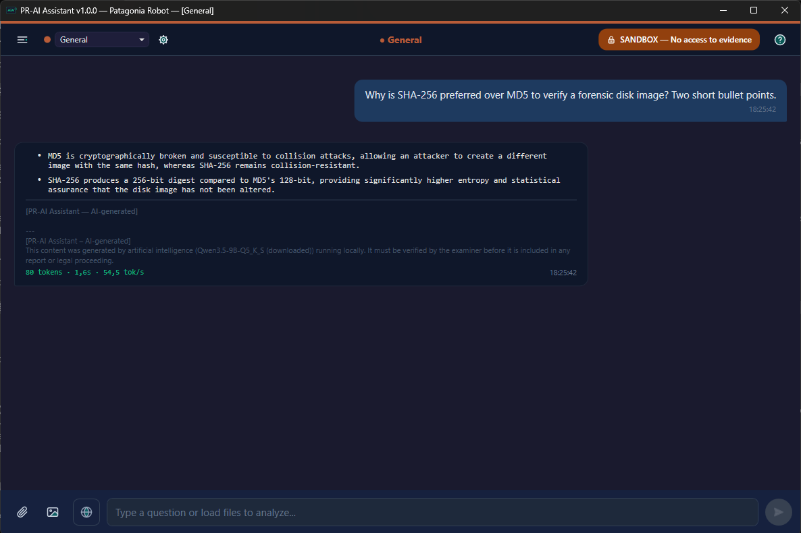
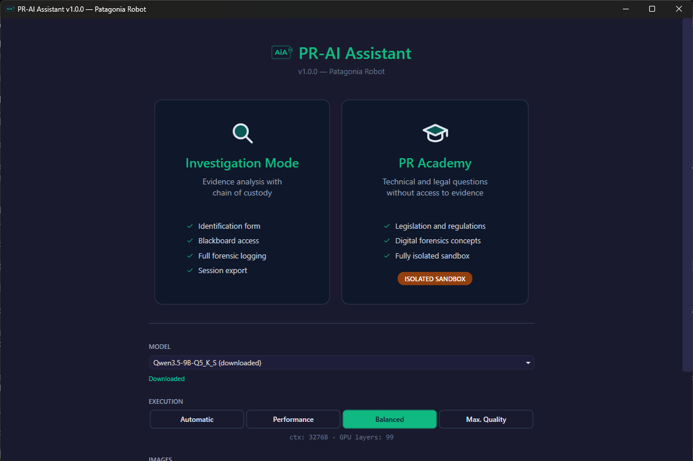
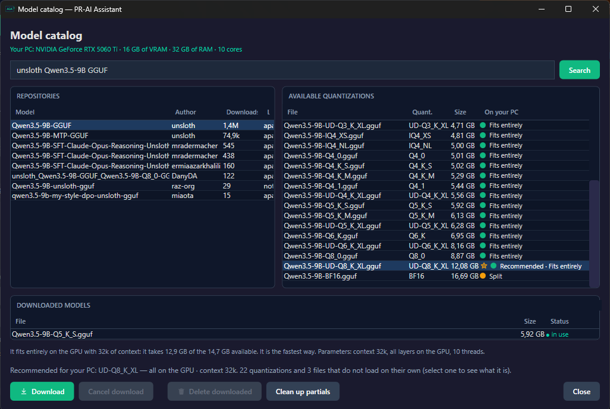

<p align="center">
  
</p>

<h1 align="center">PR-AI Assistant</h1>

<p align="center">
  A local AI assistant for Windows. Your conversations, documents and images never leave your PC.
</p>

<p align="center">
  <b>English</b> · <a href="README.es.md">Español</a>
</p>

---

PR-AI Assistant runs open language models on your own computer, with no account, no
subscription and no cloud. It was built for digital forensics work, where evidence must
not leave the examiner's machine, and it is just as useful as a private everyday
assistant.

It ships **without models**. You pick the ones you want from a built-in catalog, and the
application reads your PC (graphics card of any brand, RAM, processor) and tells you
which version of each model will run well on it.



## What it does

- **Chat with local models.** Any GGUF model from HuggingFace. Runs on the graphics card
  (NVIDIA, AMD or Intel) or on the processor if there is none.
- **Recommends for your PC.** The catalog marks the quantization that fits your hardware,
  and the *Automatic* profile sets context size, GPU layers and threads for each model.
- **Investigation Mode.** For evidence analysis: examiner identification, chain-of-custody
  logging with UTC timestamps and SHA-256 hashes, evidence files loaded as context, and
  session export to TXT, HTML or JSON.
- **PR Academy.** An isolated mode for technical and legal questions, with no access to
  evidence.
- **Image generation** (optional) with Z-Image Turbo, entirely local.
- **Web search** (optional) through a [SearXNG](https://docs.searxng.org/) instance you
  run yourself. The button only appears once you have configured one.
- **Spanish and English.** It starts in your Windows language and can be switched from
  the start screen.

| Start screen | Model catalog |
|---|---|
|  |  |

## Getting started

1. Download the latest version from the **Releases** page and unzip it anywhere.
2. Open `PR-AI-Assistant.exe`. Nothing needs to be installed: .NET is included.
3. On first launch, the app guides you to the catalog: search for a model, pick the
   recommended version (marked with a star) and download it.
4. Choose a mode, press **Start** and wait for the indicator to turn green.

The full guide is under **Help**, on the start screen, in both languages.

## Requirements

|                 | Minimum                                    | Recommended                     |
|-----------------|--------------------------------------------|---------------------------------|
| System          | Windows 10 or 11, 64-bit                   |                                 |
| RAM             | 8 GB, with small models                    | 16 GB or more                   |
| Graphics card   | Not required: runs on the CPU, more slowly | 8 GB of video memory or more    |
| For images      | A graphics card                            | 12 GB of video memory or more   |
| Disk            | About 1 GB, plus the models you download   |                                 |
| Internet        | Only to download models and for web search |                                 |

## Privacy

All inference is local. The application only uses the network when you ask it to: to
search or download models from HuggingFace, to search the web through your own SearXNG
instance, and to download the image models.

In Investigation Mode every session is logged to
`%APPDATA%\PRImager\AIAssistant\Logs\` for the chain of custody.

## Known limitations

- **AMD and Intel graphics cards are untested.** The Vulkan engine that serves them was
  tested on NVIDIA, where it works. If you have one, a report is very welcome.
- On AMD and Intel the free video memory is not measured, so the image memory indicator
  shows "unknown" (it does not prevent generating).
- Some HuggingFace repositories require accepting a license and a read token before
  downloading. The application tells you when that happens.

## Building from source

You need the [.NET 10 SDK](https://dotnet.microsoft.com/download).

```bat
dotnet build -c Debug          :: development build, with every feature
publish.bat                    :: standard edition  -> Publish\
publish.bat forense            :: forensic edition  -> Publish-Forense\
```

The engines are not in the repository, because of their size. Before running, copy them
into `src\PR-AI-Assistant\Tools\`:

- **Chat:** `llama-server.exe` and its `.dll` files from
  [llama.cpp](https://github.com/ggml-org/llama.cpp/releases) release `b8671`. The CUDA
  build goes in `Tools\`, the Vulkan build in `Tools\vulkan\`. One of the two is enough;
  the application picks the right one for the graphics card. Leave out `ggml-rpc.dll`
  and `rpc-server.exe`.
- **Images (optional):** `sd-server.exe` from
  [stable-diffusion.cpp](https://github.com/leejet/stable-diffusion.cpp/releases)
  `master-975-95b3090`, in `Tools\sd\bin\` (CUDA) or `Tools\sd\bin-vulkan\`.

The forensic edition is compiled without web search, model downloads or image
generation: that code is not in its binary at all, rather than switched off.

Release details are in [docs/DISTRIBUCION.md](docs/DISTRIBUCION.md), and the test
benches, which run against the real application, in [Tests/README.md](Tests/README.md)
(both in Spanish).

## License

PR-AI Assistant is free software under the [Apache License 2.0](LICENSE).
© 2026 Claudio Andino — Patagonia Robot.

The bundled components have their own licenses, listed in
[THIRD-PARTY-NOTICES.txt](THIRD-PARTY-NOTICES.txt). Each model you download is governed by
its own license, which the catalog shows before downloading.
